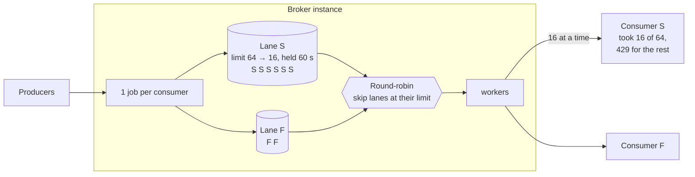
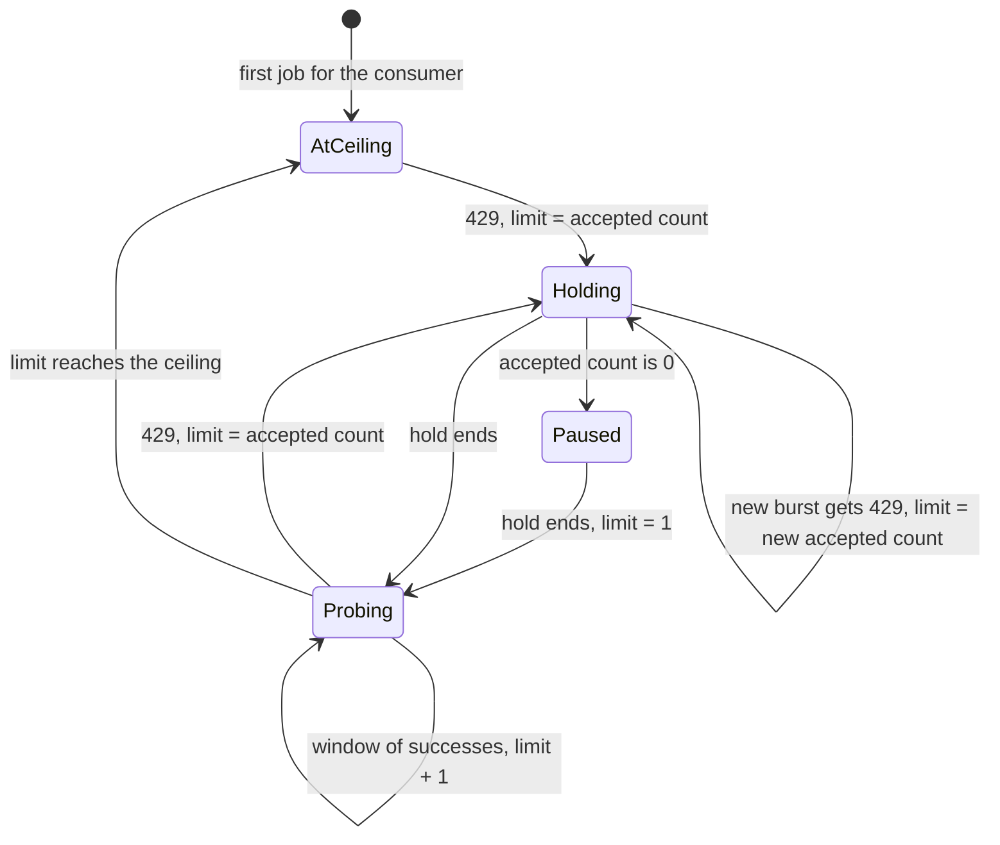

# Tech Spec: Consumer Capacity Signalling

|               |                  |
| ------------- | ---------------- |
| _Version_     | 1 (draft)        |
| _By_          | Shadman Shadab   |
| _Date_        | November 4, 2026 |
| _Last Update_ | November 4, 2026 |
| _Depends on_  | [Per-Consumer Delivery Concurrency](consumer-max-concurrency-spec.md) (PR #276) |

## Problem Statement / Goal

When a consumer is full, the polite answer is `429 Too Many Requests`: "I can't take this one now, try again later". Today the broker does not listen to that answer. It treats a `429` like any other failure:

1. The job's retry count goes up by one, and the job waits for the next retry delay (`retry-backoff-delays-in-seconds`).
2. The broker keeps sending the consumer's other queued jobs at the same concurrency. Many of them get `429` too, and each one uses up a retry.
3. After `max-retry` attempts, the job goes to the DLQ.

With the default settings, a job that keeps getting `429` is retried after 5, 30, 60, 120 and 180 seconds, and goes to the DLQ about **6.5 minutes** after its first attempt. A consumer that is busy for longer than that sends its backlog to the DLQ, even though it never failed a single message. It only said it was full.

A `429` tells the broker two things:

1. **This job should be tried again later.** It did not fail.
2. **The consumer's current capacity.** Of the deliveries the broker had in flight, the consumer accepted some and rejected the rest. The number it accepted is how many concurrent deliveries it can take right now.

**The goal:** use both.

- A `429` does not use a retry. The job is tried again later.
- The broker lowers the consumer's concurrency to what the consumer just showed it can take, and **keeps sending at that level**. It does not stop sending.
- It holds that level for a while (`Retry-After`, or a default), then tries a little more, to find out whether the consumer has scaled up.

The mechanism lives on the consumer's **lane** from PR #276.

### Non-goals

- Coordinating across broker instances. Each instance has its own lanes and measures its own limit.
- Reacting to `5xx` responses, timeouts or latency. Only `429` is a signal in this version (see [Open Questions](#open-questions)).
- Pull consumers. They control their own rate.
- Pausing consumers by hand. That is separate work, but it uses the same lane mechanism (see [Interaction with Consumer Pause](#interaction-with-consumer-pause)).

## Background: TCP Congestion Control

The idea comes from TCP. A TCP sender does not know how much the network can carry, and in 1986 the internet went through a series of "congestion collapses": senders kept sending at full speed into full routers, the packets were dropped, the senders sent them again at once, and useful throughput fell to almost nothing. Van Jacobson's fix ("Congestion Avoidance and Control", 1988, now [RFC 5681](https://www.rfc-editor.org/rfc/rfc5681)) rests on two ideas:

1. **Congestion is not loss of data.** The sender sends the data again later. Nothing is given up on.
2. **Send less for a while, then probe for more.** The sender lowers its window (how much it has in flight) and grows it again slowly, to find out when more capacity is available.

Originally the sender had to infer congestion from lost packets. [Explicit Congestion Notification](https://www.rfc-editor.org/rfc/rfc3168) (ECN, RFC 3168) later let the network **signal** it directly, by marking packets before it had to drop them.

A webhook broker has the same problem, and `429` ([RFC 6585](https://www.rfc-editor.org/rfc/rfc6585)) is the consumer's ECN mark: an explicit signal that it is full. That is where the name **capacity signalling** comes from. Today the broker behaves like a pre-1988 TCP sender: it treats the signal as a failure and keeps sending at the same rate.

| TCP | Capacity signalling |
| -- | -- |
| Congestion signal: an ECN mark, or a lost packet | `429` response |
| The segment is not lost; it is sent again | The job is not failed; it is queued again without using a retry |
| Congestion window (`cwnd`): how much may be in flight | The lane's limit |
| Lower the window, then grow it again slowly to probe for more | Set the limit to the measured capacity, hold it, then grow it by 1 to probe for more |
| Receiver window (`rwnd`): the most the receiver will accept | Ceiling: the fixed per-consumer limit from PR #276, or `max-workers` |

### Where it differs from classic TCP

- **The limit goes to the measured capacity, not to half.** Classic TCP halves its window on congestion. It halves partly because it cannot see how much the network accepted, and partly so that separate connections sharing a link end up with fair shares. Neither applies here. The broker can see exactly how many deliveries the consumer accepted. And all broker instances deliver the *same* consumer's backlog, so it does not matter how they split the consumer's capacity between them. Newer TCP algorithms such as BBR ([Cardwell et al., 2016](https://queue.acm.org/detail.cfm?id=3022184)) work the same way: they measure the capacity and send at it, instead of halving.
- **No full stop, unless the consumer took nothing.** Lowering the limit to the measured capacity already removes the overload. Stopping completely would waste capacity the consumer just showed it has. The broker stops a lane only when the consumer accepted none of its deliveries.
- **The limit starts at the ceiling.** TCP starts small because a new connection knows nothing about the network. The broker already sends to a consumer up to the ceiling today, so it starts there. A consumer that never sends `429` sees no change.

## Concepts

| Concept | Definition |
| -- | -- |
| Lane | As in PR #276: the in-memory queue of one consumer's waiting jobs on one instance, with its in-flight count and its limit. It is keyed by `channelID/consumerID`. A `429` applies to the lane. |
| Signal | A `429` response from the consumer. |
| Burst | The lane's deliveries that were in flight when a signal arrived. Their `429`s all come from the same overload. |
| Accepted count | The number of deliveries in a burst that did not get `429`. It is the consumer's capacity right now. |
| Hold | A period after a signal when the lane keeps sending at the accepted count, without growing it. |
| Pause | A hold with nothing sent. Only used when the consumer accepted nothing. |
| Throttled job | A job that got `429`. It goes back to `QUEUED` with its retry count unchanged. |

## Design

### Where the change applies

PR #276 gives each consumer its own lane on each instance. A worker only takes a job from a lane that is *ready*: it has queued jobs and fewer deliveries in flight than its limit. This design changes the lane's limit at runtime, based on `429`s. The HTTP API and the request sent to the consumer do not change.

| Outcome of a delivery | Today | With capacity signalling |
| -- | -- | -- |
| `2xx` | Delivered | Delivered. Counts toward growing the limit again, after a hold. |
| `429` | Failure: retry count +1, the job dies after `max-retry` | The job goes back in its lane without using a retry. The lane's limit drops to the accepted count and is held there. |
| Any other failure | Normal retry | Normal retry. The limit does not change. |



### Rules

1. **A `429` is not a failure.** The worker marks the job `QUEUED` again **without** increasing `retryAttemptCount` (see [Storing a throttled job](#storing-a-throttled-job)). The job goes back into its lane with its original priority and position, and goes out again as soon as the lane has room.
2. **Measure the capacity.** On the first `429` of a burst, record `N`, the lane's in-flight count at that moment (including the job that got the `429`), and set `R = 1`. Each later `429` for a job that was dispatched before that moment belongs to the same burst and adds 1 to `R`. Each job records the time it was dispatched so the broker can tell.
3. **Set the limit to the accepted count.** The lane's limit becomes `N − R`, never above the ceiling. It is updated on every `429` in the burst, so it settles at what the consumer actually accepted. The lane keeps sending at this limit.
4. **Hold the limit.** For the length of the hold, the limit does not grow. The hold lasts for the `Retry-After` value ([RFC 9110](https://www.rfc-editor.org/rfc/rfc9110#field.retry-after)), in seconds or as an HTTP date, capped at `max-hold-seconds`. If the header is missing, malformed or in the past, it lasts `hold-seconds`. A later `429` can make the hold longer, never shorter.
5. **Pause only when nothing was accepted.** If `N − R` is 0, the consumer took none of the burst. Then the lane sends nothing until the hold ends, and resumes with a limit of 1. This is the only case where the broker stops sending to a consumer completely.
6. **A new signal during the hold** comes from a job dispatched at the lowered limit, so it starts a new burst (rule 2): the consumer's capacity has dropped further. The limit drops to the new accepted count, and the hold restarts.
7. **Probe for more after the hold.** Once the hold has ended, the limit grows by 1 for each round of `limit` successful deliveries, up to the ceiling. A success counts only if the lane was using its whole limit when the job was dispatched, so that a quiet consumer does not grow its limit without showing it can take the load. The next `429` goes back to rule 2.
8. **Start at the ceiling.** A lane with no signal history starts with its limit at the ceiling, as in PR #276. A consumer that never sends `429` sees no change.
9. **Remember.** A lane that has had a signal is kept for 10 minutes after it goes idle, so that its measured limit is not lost between bursts of traffic. After that it is deleted as in PR #276, and the next lane starts at the ceiling.



### What `Retry-After` means

For capacity signalling, `Retry-After` on a `429` means **how long the consumer expects to stay at its current capacity**. The broker does not stop sending for that long. It keeps sending at the accepted count, and waits that long before it tries to send more.

This is a deliberate reading of the header. [RFC 9110](https://www.rfc-editor.org/rfc/rfc9110#field.retry-after) defines `Retry-After` as how long to wait before the next request. That reading fits a client that sends one request at a time. It does not fit a broker with many deliveries in flight to the same consumer, where a `429` rejects only some of them while the consumer goes on serving the rest. The two readings agree in one case: when the consumer accepted nothing (rule 5), the broker sends nothing until `Retry-After` has passed.

Consumer owners should set `Retry-After` to how long they expect to need before they can take more, for example the time their autoscaler takes to add capacity.

### Example

A consumer `bulk-indexer` can take 16 concurrent requests. Its autoscaler adds capacity for 8 more a few minutes after load rises. When it is full, it returns `429` with `Retry-After: 60`. The broker has a large backlog for it, and its ceiling is 64.

| Time | Event | Lane limit |
| -- | -- | -- |
| 0 s | Burst: the broker sends 64 at once, as today | 64 |
| ~0 s | The consumer accepts 16 and returns `429` for 48. `N = 64`, `R = 48` | 64 → **16**, held 60 s |
| 0–60 s | The broker keeps 16 deliveries in flight. The 48 throttled jobs go out as slots free up, with no retries used. | 16 |
| 60 s | Hold ends. Probing | 16 → 17 |
| ~61 s | 17 is one over capacity: one `429`. `N = 17`, `R = 1` | 17 → **16**, held 60 s |
| ~180 s | The consumer has scaled to 24. After the next hold, probing finds it | 16 → … → 24 |
| ~… | 25 gets one `429` | 25 → **24**, held 60 s |

The consumer is kept at its capacity the whole time. It sees one burst of `429`s at the start, and after that **one `429` per hold**, when the broker probes for more. Nothing reaches the DLQ.

A cooldown that stopped sending would deliver nothing for 60 s after each `429`, even though the consumer had just shown it could take 16 at a time.

### Storing a throttled job

A new repository method, `MarkJobThrottled(job, earliestNextAttemptAt)`:

```sql
UPDATE job
SET status = QUEUED, statusChangedAt = ?, updatedAt = ?, earliestNextAttemptAt = ?
WHERE id = ? AND status = INFLIGHT
```

It is the same as `MarkJobRetry`, but it does not increase `retryAttemptCount`. `earliestNextAttemptAt` is now, so the job can go out again as soon as its lane has room. When the lane is paused (rule 5), it is the end of the hold.

The worker also puts the job back into its lane in memory. If the instance stops first, the retry sweep (`GetJobsReadyForInflightSince`) picks the job up from the database, as for any queued job. The duplicate check from PR #276 stops the sweep from queuing a job the lane already holds.

### Changes to the lane

| Change | Detail |
| -- | -- |
| New lane fields | `holdUntil`; `paused`; `cutAt`, `cutInflight` (`N`), `cutRejected` (`R`); `successes`; `idleSince` |
| `Job.dispatchedAt`, `Job.saturated` | Set in `tryNext`: when the job left the lane, and whether the lane was at its limit then. Used by rules 2 and 7. |
| `done(job, outcome)` | On `429`: rules 1–6. On `2xx`: rule 7. Other outcomes: no change to the limit. |
| `consumerLane.canRun()` | Also false while `paused`. The lowered limit needs no change here: `hasRoom()` already compares the in-flight count with `limit`. Note that `limit = 0` means "no limit" in PR #276, so a pause must be its own flag, not a limit of 0. |
| Pause timer | Only for a pause. When the hold ends, it clears `paused`, sets the limit to 1, adds the lane back to the ready list and calls `signal()`. A hold without a pause needs no timer: rule 7 checks the time on each success. |
| Lane deletion | A lane that has had a signal is not deleted until it has been idle for 10 minutes (rule 9). A periodic sweep deletes such lanes. |

A lane is keyed by `channelID/consumerID`, so a `429` from a consumer on one channel does not lower the limit for the same consumer ID on another channel. That matches how PR #276 counts the limit.

All state is on the lane, in memory. A consumer that never sends `429` has no extra state, and its lane is created and deleted exactly as in PR #276. On restart, lanes are lost and every consumer starts again at its ceiling. A consumer that is still full signals again in the first burst.

### Changes to the worker

1. `callConsumer` returns a delivery outcome (status code, parsed `Retry-After`) instead of only an error. `deliverJob` uses it to choose between `MarkJobDelivered`, `MarkJobThrottled`, `MarkJobRetry` and `MarkJobDead`.
2. `Worker.onDone` passes the outcome to the scheduler: `onDone(job, outcome)`.

## Configuration

There is **no per-consumer setting**. The consumer opts in by sending `429`. A consumer that never sends it is not affected, and a consumer that does is asking for exactly this behaviour. The per-consumer ceiling already exists: `[consumer-max-concurrency]` from PR #276.

```ini
[capacity-signalling]
enabled=false
hold-seconds=60
max-hold-seconds=600
```

| Key | Default | Meaning |
| -- | -- | -- |
| `enabled` | `false` | Turns capacity signalling on for all push consumers. When `false`, a `429` is a normal failure, as today. |
| `hold-seconds` | `60` | How long the measured limit is held after a `429` that has no valid `Retry-After`, before the broker probes for more |
| `max-hold-seconds` | `600` | Upper bound on any hold, including one from `Retry-After` |

Invalid values log a warning and fall back to the default, as the PR #276 keys do.

### Behaviour change when enabled

Turning the feature on changes one thing for existing consumers: **a `429` no longer uses up a retry.** A consumer that today returns `429` for a reason that is not about capacity, for example a quota that stays exhausted for days, would keep its jobs out of the DLQ for as long as it keeps returning `429`. Before enabling, check which consumers return `429` today and why (open question 2).

## Multiple Instances

Each instance has its own lanes, so each measures its own accepted count. When a consumer is full, each instance that sends to it gets some `429`s and lowers its own limit to what the consumer accepted from it. Together the instances settle at about the consumer's capacity. How the capacity is split between instances does not matter, because they all deliver the same consumer's backlog.

## Interaction with Consumer Pause

Pausing a consumer by hand (separate work in progress) and a pause under rule 5 both stop a lane from being ready. They must stay separate:

- A manual pause is set by an operator, is stored, and lasts until it is lifted. A rule 5 pause is automatic, in memory, and short.
- A manually paused lane is never ready, whatever its limit or hold.

Both should be checked in `consumerLane.canRun()`, so that the two combine without special cases.

## Failure Handling

| Event | Result |
| -- | -- |
| Consumer always returns `429` | Its jobs never use up retries, so they never reach the DLQ. The lane pauses (rule 5) and sends one request per hold. The metrics show this; see open question 1. |
| `MarkJobThrottled` fails (for example, another instance already changed the job) | Log it and do not put the job back in the lane. The database row is the source of truth, and the recovery workers will find the job. The limit still changes, because the consumer did signal. |
| `Retry-After` is missing, malformed or in the past | Use `hold-seconds` |
| `Retry-After` is very large | Capped at `max-hold-seconds` |
| Process restarts | Lanes are lost, with their measured limits. Each consumer starts again at its ceiling. |
| Pause timer fires after the dispatcher has stopped | The timer only changes the lane and calls `signal()`, which does not block, so a late call does nothing |

## Observability

New metrics, labelled by `channel` and `consumer`:

| Metric | Type | Meaning |
| -- | -- | -- |
| `consumer_concurrency_limit` | Gauge | The lane's current limit on this instance (the ceiling when the consumer has not signalled) |
| `consumer_capacity_signal_total` | Counter | `429` responses received |
| `consumer_lane_paused` | Gauge | `1` while the lane is paused under rule 5, `0` otherwise |

These sit next to `consumer_inflight_job_count` and `consumer_queued_job_count` from PR #276. A consumer whose limit stays well below its ceiling while its queue grows cannot keep up with its traffic.

The broker logs each change to the limit at `info`, with the old and new limit, the accepted count and the hold length.

## Testing

**Unit tests (lane):**

- A `429` sets the limit to `N − R`, and later `429`s from the same burst lower it further.
- The lane keeps sending at the new limit; it is not paused.
- When every delivery in the burst gets `429`, the lane pauses, and resumes at a limit of 1 when the hold ends.
- A `429` for a job dispatched after the cut starts a new burst and restarts the hold.
- The limit does not grow during the hold, grows by 1 per saturated window after it, and never goes above the ceiling.
- Hold length from `Retry-After` in seconds, as an HTTP date, missing, malformed, in the past, and above the cap.
- A lane that has had a signal is kept for 10 idle minutes; a lane that has not is deleted as in PR #276.
- A `429` on one channel does not change the same consumer ID's lane on another channel.

**Unit tests (worker / repository):**

- With the feature on, a `429` calls `MarkJobThrottled`, leaves `retryAttemptCount` unchanged, and puts the job back in its lane at its original position.
- With the feature off, a `429` keeps today's retry behaviour.
- `MarkJobThrottled` changes only an `INFLIGHT` row, leaves `retryAttemptCount` alone and sets `earliestNextAttemptAt`.

**Integration test:** a test consumer that accepts up to `K` concurrent requests and returns `429` beyond that, raises `K` part-way through, and runs for longer than the default retry schedule (more than 6.5 minutes). Assert that:

- all messages are delivered and none reach the DLQ;
- the broker's in-flight count to the consumer stays close to `K` and follows it up;
- a second consumer that never signals sees the same in-flight count as with the feature off.

## Rollout

1. Merge PR #276 (lanes) first.
2. Ship with `[capacity-signalling] enabled=false`. Behaviour does not change.
3. Find the consumers that return `429` today (from broker logs) and confirm that each one means "I'm full, try again later".
4. Turn the feature on in one environment and watch the new metrics and the DLQ.
5. Document for consumer owners: when you are full, return `429` for the requests you cannot take, and keep serving the rest. Set `Retry-After` to how long you expect to stay at this capacity (see [What `Retry-After` means](#what-retry-after-means)). A consumer that answers overload with `500` or a timeout still goes through normal retries.

## Open Questions

1. **Endless signalling.** A consumer that returns `429` forever keeps its jobs out of the DLQ forever. Do we want a cap, for example "after `max-signal-duration` in a row, count `429` as a failure again"?
2. **Per-consumer opt-out.** Only needed if a consumer uses `429` for something other than capacity (step 3 of the rollout). If we find one, add `[capacity-signalling-disabled]` with `channelID/consumerID` or `consumerID` keys, matched like `[consumer-max-concurrency]`.
3. **Other signals.** Should `503` with `Retry-After` be treated the same as `429`?
4. **Signals across channels.** A lane is per channel, so a consumer service registered on several channels lowers its limit only on the channel that got the `429`. If one service behind several consumer records is common, a signal could also apply to every lane with the same callback host.
5. **Shared state across instances.** If instances probing at the same time cause too many `429`s, the measured limit could be shared (for example, in the database). This is out of scope for the first version.
