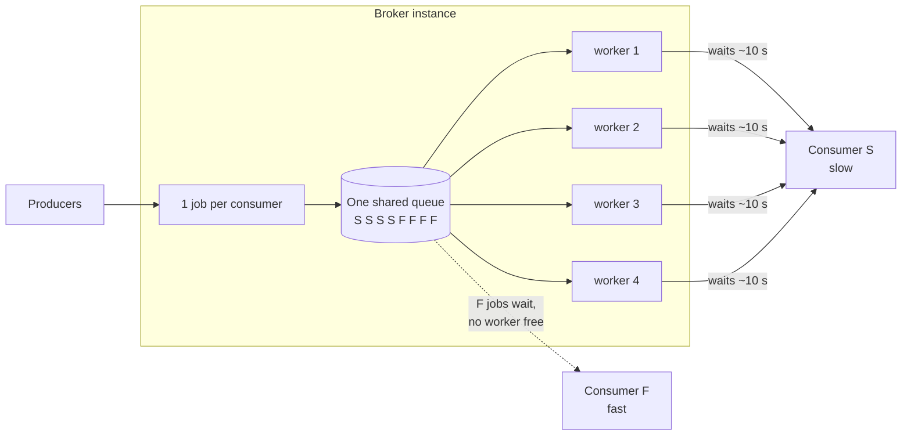
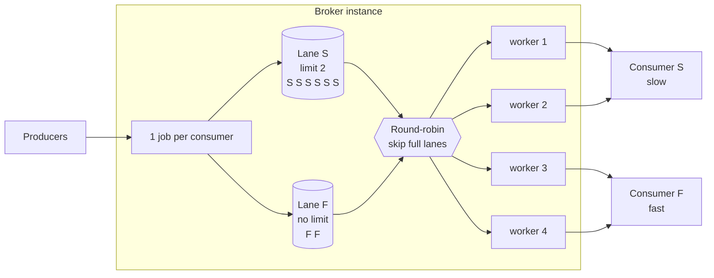
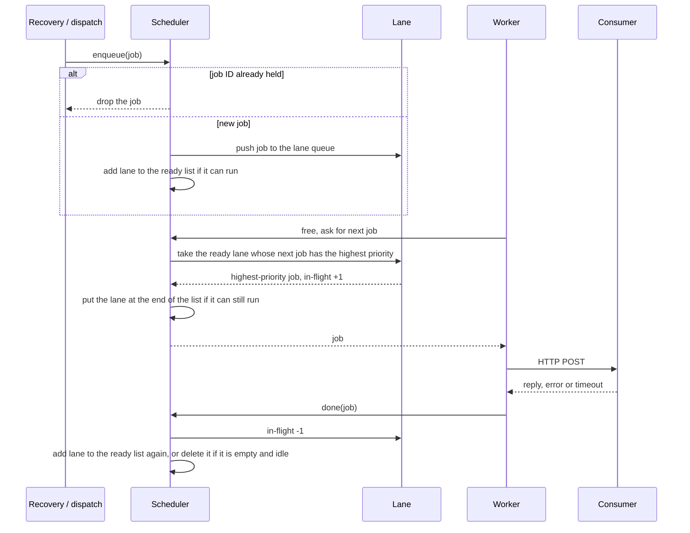
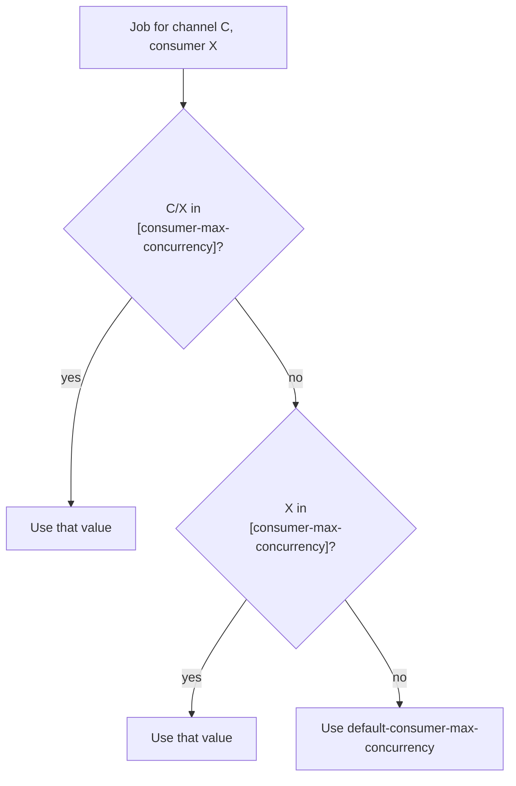

# Tech Spec: Per-Consumer Delivery Concurrency

|               |                  |
| ------------- | ---------------- |
| _Version_     | 1                |
| _By_          | Shadman Shadab   |
| _Date_        | November 2, 2026 |
| _Last Update_ | November 4, 2026 |

## Problem Statement / Goal

A broker instance delivers messages with a fixed pool of workers (`max-workers`). All consumers share this pool. A worker sends one HTTP request to a consumer and stays busy until the consumer replies or the request times out.

A slow consumer therefore holds its workers for longer than a fast consumer does. When many jobs are queued, each worker that becomes free takes the next job in the shared queue. Over time the slow consumer's jobs hold almost all the workers, and the jobs of every other consumer wait behind them. A fast consumer then sees a long delay that it did not cause.



The goal is to limit how many deliveries one consumer can have running at once on an instance. A slow consumer can then delay only its own jobs, and the other workers stay available for the other consumers.

## Concepts

| Concept | Definition |
| -- | -- |
| Consumer | A system that receives webhooks from the broker. It is outside the broker. |
| Worker | A goroutine inside the broker that delivers one job at a time. Each instance has `max-workers` of them. |
| Lane | The in-memory queue of one consumer's waiting jobs on one instance, together with the count of its running deliveries. |
| In-flight count | The number of the consumer's deliveries that a worker is running now on this instance. |
| Max concurrency | The highest in-flight count that a consumer can have on one instance. `0` means no limit. |

## Design

### Where the change applies

Only the dispatcher changes: how the broker queues jobs in memory and gives them to workers. The HTTP API, the database, retries, and the request sent to the consumer do not change.

| Step | Before | After |
| -- | -- | -- |
| 1. Producer publishes a message | | No change |
| 2. Broker stores it and makes one delivery job per consumer | | No change |
| 3. Job is queued in memory | One shared priority queue | The lane of the job's consumer |
| 4. A free worker gets a job | The front of the shared queue | The highest-priority job among the lanes below their max concurrency; round-robin between lanes for equal priority |
| 5. Worker sends the HTTP request and waits | | No change |
| 6. Delivery attempt ends | Worker is free again | Worker is free again, and the lane's in-flight count goes down by one |



### Lane data

Each lane holds:

| Field | Purpose |
| -- | -- |
| Channel ID, consumer ID | The lane key. They are also used to find the limit in the configuration and to label the metrics. The same consumer ID on two channels has two lanes. A consumer that is deleted and created again while its old jobs run keeps one lane and one limit. |
| Queue | A priority heap of the consumer's waiting jobs. |
| In-flight count | The number of the consumer's deliveries running now. |
| Limit | The consumer's max concurrency. |
| Ready flag | Shows that the lane is in the round-robin list, so that it is not added twice. |

The scheduler also keeps the IDs of all jobs that it holds (queued or running) in one set, to find duplicates.

A lane does not store response times or error counts, and it does not store anything in the database. It exists only while its consumer has queued or running jobs.

### Scheduling

The scheduler keeps a **ready list**: the lanes that have at least one waiting job and have an in-flight count below their limit. A lane is in the list at most once.



The rules:

1. **Enqueue.** If the job ID is already held on this instance, drop the job. If not, record the ID, put the job in its consumer's lane (make the lane if it does not exist), and add the lane to the end of the ready list if it can run.
2. **Next job.** The dispatch loop first waits for a free worker. Then it looks at the next job of each lane in the ready list and takes the lane whose next job has the highest priority. When several lanes have the same priority, it takes the one nearest the front of the list. It takes that lane's next job and increases the lane's in-flight count by one. If the lane can still run, it goes to the end of the ready list, so lanes with equal priority take turns. If no lane can run, the loop waits until a job is queued or a delivery ends.
3. **Done.** When the delivery attempt ends (success, failure or timeout), remove the job ID from the held set and decrease the in-flight count by one. If the lane now has room and waiting jobs, add it to the ready list again. If it has no waiting and no running jobs, delete it.
4. **Order.** A job with a higher priority goes first, across all lanes that can run, as it did with the shared queue. In a lane, the older of two jobs with the same priority goes first. A lane at its limit is skipped even when its next job has the highest priority.
5. **Stop.** When the dispatcher stops, it drops the jobs that are still waiting in lanes. It also releases the slot of a job that a worker did not read before it stopped. These jobs stay queued in the database, and the next dispatcher queues them again.

A job is taken from a lane only when a worker is ready for it. So a job never holds a slot while it waits for a worker.

### Example

One instance with 4 workers. At t = 0 s, 8 jobs arrive for the slow consumer S (each delivery takes 10 s). At t = 1 s, 4 jobs arrive for the fast consumer F (each delivery takes 1 s). S has max concurrency 2.

Before: the shared queue gives every free worker to S, so F waits 19 s.

```mermaid
gantt
    dateFormat s
    axisFormat %S s
    section worker 1
    S1 :0, 10s
    S5 :10, 10s
    F1 :crit, 20, 1s
    section worker 2
    S2 :0, 10s
    S6 :10, 10s
    F2 :crit, 20, 1s
    section worker 3
    S3 :0, 10s
    S7 :10, 10s
    F3 :crit, 20, 1s
    section worker 4
    S4 :0, 10s
    S8 :10, 10s
    F4 :crit, 20, 1s
```



After: S can hold only 2 workers, so workers 3 and 4 take F jobs as soon as they arrive.

```mermaid
gantt
    dateFormat s
    axisFormat %S s
    section worker 1
    S1 :0, 10s
    S3 :10, 10s
    S5 :20, 10s
    S7 :30, 10s
    section worker 2
    S2 :0, 10s
    S4 :10, 10s
    S6 :20, 10s
    S8 :30, 10s
    section worker 3
    F1 :crit, 1, 1s
    F3 :crit, 2, 1s
    section worker 4
    F2 :crit, 1, 1s
    F4 :crit, 2, 1s
```



| | Before | After (S limit 2) |
| -- | -- | -- |
| Longest wait for an F job | 19 s | 1 s |
| Last F job done | t = 21 s | t = 3 s |
| Last S job done | t = 20 s | t = 40 s |

### Why a limit, and not only round-robin

Between lanes with equal priority, round-robin gives each lane one job per turn. It counts jobs, not time. An S job holds its worker 10 times longer than an F job, so with round-robin alone, S soon holds most of the workers again: each free worker goes to S half of the time, and S workers stay busy 10 times longer. The limit is the part that keeps workers free for other consumers. The round-robin makes sure that each lane with room gets a turn.

### Duplicate jobs

The recovery workers run every `rational-delay-in-seconds` and queue all jobs that the database shows as queued. Before this change, a job that was already in the in-memory queue went in again on each pass. Each copy later failed when it tried to mark the job in flight. The scheduler now drops a job whose ID it already holds, and the recovery pass skips such a job before it takes the job's lock, so a large backlog that a consumer at its limit keeps does not cost a lock write per job on every pass. This check is per instance, and it holds a job only until its attempt ends.

A copy can still go out of date. For example, instance A queues a job in a lane at its limit, instance B's recovery pass also queues it and delivers it, and the attempt fails, so the job is queued again with a higher retry attempt count and a later earliest next attempt. A's copy still has the old count. To refuse such a copy, `MarkJobInflight` accepts the job only when the database shows it as queued **and** its retry attempt count matches the copy's. The recovery pass on A does not skip the fresh row while A still holds the old copy: when the old copy is still waiting in its lane, the fresh copy's data replaces it in place, so the job keeps its place. When the old copy has already been handed to a worker, it fails to go in flight, its slot is freed, and the next recovery pass queues a fresh copy when the job is due. Without this check, lanes make the problem worse than before, because a copy can wait in a lane for minutes: in a two-instance test with a failing consumer limited to 1, messages got 7 to 9 attempts instead of `1 + max-retry` = 6.

### Per-instance limit

Each instance has its own lanes and counts. With `N` instances, a consumer can have up to `N × max concurrency` deliveries running in total. A shared count across instances would need a database or cache call for each job, and this design does not add one.

## Configuration

Max concurrency is set only in the broker configuration file. The HTTP API does not set it and does not return it, and the database does not store it.

```ini
[broker]
default-consumer-max-concurrency=0

[consumer-max-concurrency]
slow-consumer=2
step-events/slow-consumer=5
```

**`default-consumer-max-concurrency`** in `[broker]` applies to every consumer that has no override.

| Value | Result |
| -- | -- |
| `0` (default) | No limit. Jobs go out highest priority first, as before. For equal priority, consumers take turns, where before the order was not fixed. |
| `N > 0` | Each consumer can have up to `N` deliveries running on each instance. |
| Not a non-negative integer | The broker logs a warning and uses `0` (no limit). |

**`[consumer-max-concurrency]`** holds overrides for single consumers. The value can be higher or lower than the default.

- The key is `channelID/consumerID` (one consumer on one channel) or `consumerID` (that consumer ID on every channel).
- A `consumerID` key sets the limit for each channel separately. For example, `slow=2` with consumer `slow` on 3 channels allows 6 deliveries at once to that consumer. To limit the total, set a lower value.
- When both keys match, `channelID/consumerID` wins.
- `0` removes the limit for that consumer.
- IDs are case-sensitive.
- The broker ignores a value that is not a non-negative integer, logs a warning, and uses the default.
- Wrap a key that contains `:` or `=` in backticks (`` `ns:consumer`=2 ``). Without them, the INI parser splits the key.



A change to the configuration file takes effect in the same way as a change to any other setting: the broker restarts its services in the same process (or stops, when `StopOnConfigChange` is set). The lanes are in memory, so they start empty, and the recovery workers queue the waiting jobs again from the database.

### Choosing a value

- Look at `consumer_inflight_job_count` for the consumer under normal load, and at its response time. Set the limit a little above the normal in-flight count.
- A limit reduces the slow consumer's throughput: with limit `L` and a response time of `T` seconds, one instance delivers at most `L / T` jobs per second to that consumer. If the consumer must keep its throughput, raise `max-workers` when you set the limit.
- A lane at its limit does not use free workers, even when no other lane has jobs. The free workers stay idle until other jobs arrive.
- A consumer at its limit keeps a backlog of queued jobs. Each recovery pass, on every instance, still loads all the due queued jobs from the database (with their messages), even though it skips the ones the instance already holds. A very large backlog therefore costs database reads and memory on every pass; raise the limit or `max-workers`, or fix the consumer, rather than let the backlog grow without bound.

## Failure Handling

| Event | Result for the lane |
| -- | -- |
| Consumer returns an error or the request times out | The attempt ends normally and the in-flight count goes down. The HTTP timeout (`connection-timeout-in-seconds`) is the longest time that one delivery holds a slot. |
| Panic during the HTTP call | The worker catches it and treats it as a failed delivery. The in-flight count goes down. |
| Another instance already claimed the job | `MarkJobInflight` fails, the attempt ends, and the in-flight count goes down. |
| The copy is out of date: an attempt on another instance failed after this instance queued it | `MarkJobInflight` refuses it because the retry attempt count differs, the attempt ends, and the in-flight count goes down. A copy that is still waiting is refreshed in place by the next recovery pass instead. |
| Panic outside the HTTP call, or the process is killed | The whole process stops, and its lanes go with it. The jobs stay in the database as queued or in flight, and the recovery workers deliver them again. This is the same as before this change. |
| A database call in the worker never returns | The worker never finishes the attempt, so the lane keeps one slot in use until the process restarts. Before this change, the same hang already removed the worker from the pool. |

## Observability

Two new gauges, labelled by `channel` and `consumer`:

| Metric | Meaning |
| -- | -- |
| `consumer_queued_job_count` | Jobs waiting in the consumer's lane on this instance |
| `consumer_inflight_job_count` | Deliveries running now to the consumer from this instance |

A consumer whose in-flight count stays at its limit while its queued count grows is slower than its limit allows for the current traffic.

## Memory

The broker held all queued jobs in memory before this change, and it holds the same jobs now, split across lanes. The added memory is one entry in the held-ID set and one sequence number per job (about 100 bytes), and one small struct per active lane. Because duplicates are dropped, the broker can hold fewer jobs under load than before.
